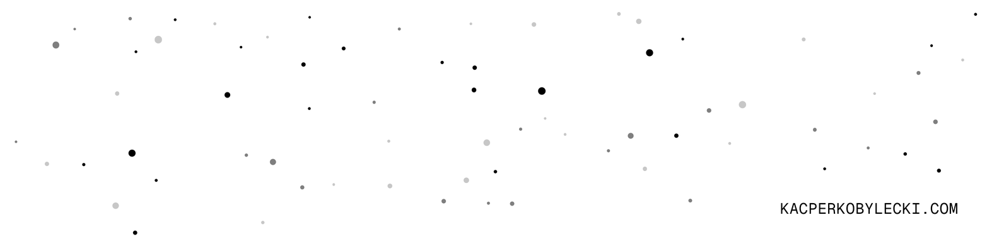
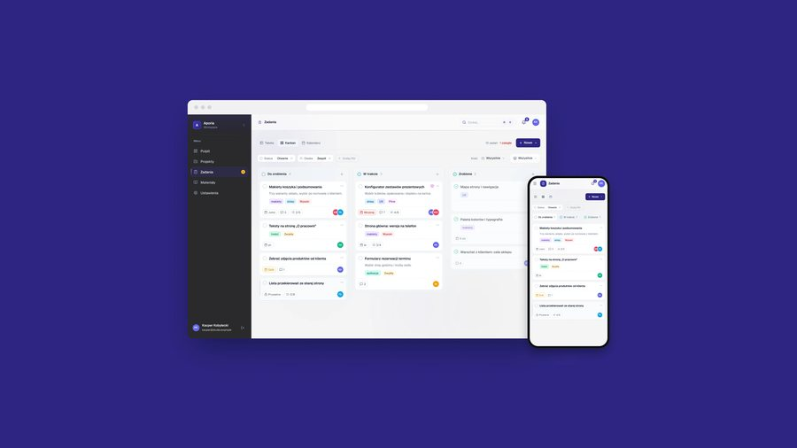
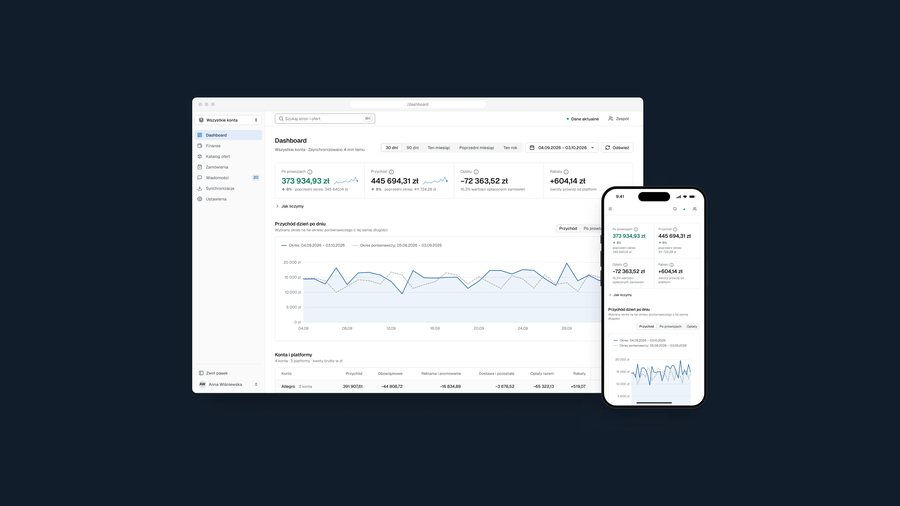
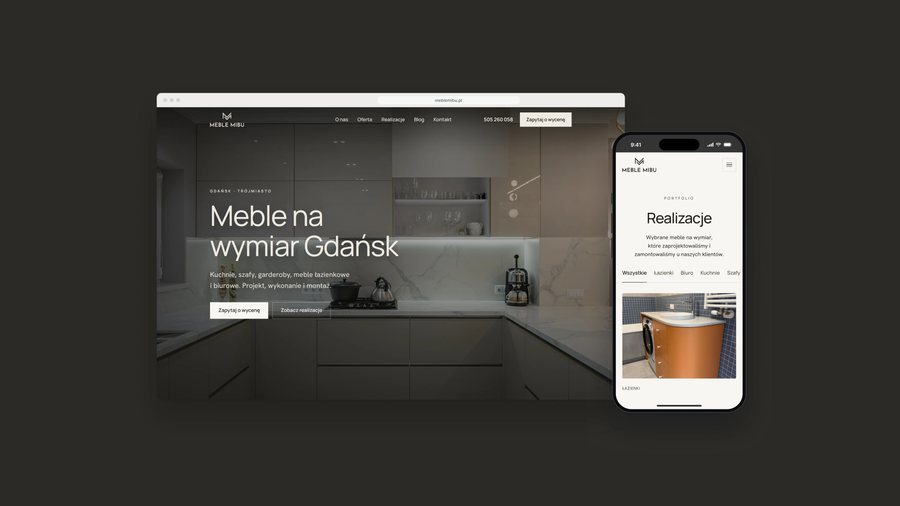

<a href="https://kacperkobylecki.com/">
  <picture>
    <source media="(prefers-color-scheme: dark)" srcset="assets/banner-dark.png">
    
  </picture>
</a>

### Kacper Kobyłecki

Digital / Product Designer · Gdańsk

I design web apps, admin panels, online shops and websites: UI and design systems in Figma, with hands-on frontend experience in Vue and Nuxt.

#### Case studies

  
  
  

[Aporia Pro](https://kacperkobylecki.com/work/aporia-pro) · [Marketplace Panel](https://kacperkobylecki.com/work/marketplace-panel) · [Meble MiBu](https://kacperkobylecki.com/work/meble-mibu)

[Portfolio](https://kacperkobylecki.com/) · [LinkedIn](https://www.linkedin.com/in/kacper-koby%C5%82ecki/) · [hello@kacperkobylecki.com](mailto:hello@kacperkobylecki.com)
